# Segmented Network Lab on AWS — Console Build + Terraform/Ansible

A self-hosted, segmented infrastructure environment on AWS — modeled on a
production on-prem DMZ/LAN/VPN architecture I built and hardened at work,
reimplemented here with sanitized names, IPs, and domains for a public
portfolio.

This repo contains **two parallel versions** of the same architecture:

1. **A real, hand-built deployment** (documented in full in
   [`docs/BUILD_LOG.md`](docs/BUILD_LOG.md)) — built manually through the AWS
   Console specifically for hands-on AWS Solutions Architect Associate exam
   practice, then hardened, containerized, and wired up with a working
   CI/CD pipeline.
2. **An Infrastructure-as-Code version** (`terraform/` + `ansible/`) —
   the same network topology and hardening steps, expressed as repeatable,
   version-controlled code instead of console clicks.

Building it by hand first, then codifying it, was deliberate: it's the
difference between clicking through a wizard and actually understanding what
each resource does — which is also exactly what the SAA exam tests.

## What this demonstrates

- **Network segmentation** — public (DMZ-equivalent) and private
  (LAN-equivalent) subnets, with a bastion host as the only entry point,
  NAT Gateway for outbound-only private access
- **Server hardening** — SSH key-only auth, root login disabled, role-named
  service accounts, fail2ban — done manually first, then via reusable
  Ansible roles
- **Self-hosted services** — a self-hosted Git server (Gitea) and a
  containerized app (Node.js/Express + a self-authored Dockerfile), both
  running in the private subnet, reachable only through the bastion
- **CI/CD** — a real, working Gitea Actions pipeline: pushing code
  automatically rebuilds the Docker image and redeploys the container, with
  zero manual `docker` commands after setup
- **Infrastructure as Code** — the same topology reproduced in Terraform,
  with a GitHub Actions job that validates it on every push
- **Debugging discipline** — every real issue hit along the way (security
  group gaps, SSH config mistakes, a corrupted config file, dynamic-IP
  lockouts) is documented with its actual root cause and fix in
  [`docs/BUILD_LOG.md`](docs/BUILD_LOG.md) — troubleshooting is as much a
  part of this project as the final working state

## Architecture

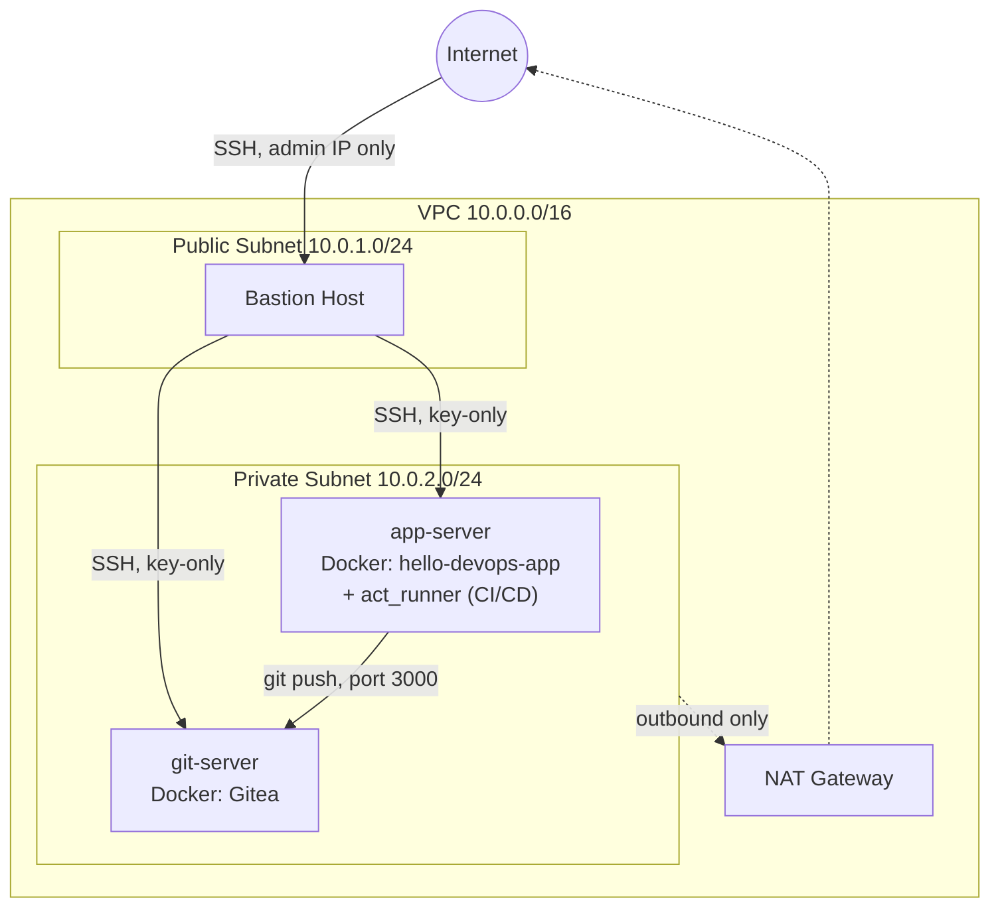

This mirrors a real DMZ/LAN/VPN-segmented on-prem network I run at work: a
single hardened entry point, everything else reachable only through it, and
no direct internet exposure for internal services.

**How CI/CD works end-to-end:** a push to the `main` branch on Gitea
(git-server) triggers a Gitea Actions workflow, executed by a self-hosted
runner living on app-server. The runner rebuilds the Docker image and
replaces the running container — no manual `docker build`/`docker run`
after the initial setup. Full details in
[`docs/BUILD_LOG.md`](docs/BUILD_LOG.md).

## Repo layout

```
terraform/   VPC, subnets, security groups, EC2 instances (IaC version)
ansible/     SSH-hardening and fail2ban roles (IaC version)
docs/        Full build log — all 4 phases, every issue and its real fix
```

## Screenshots

| | |
|---|---|
| **Route table wired to NAT Gateway** | **Security group rules (bastion-sourced + self-referencing)** |
| 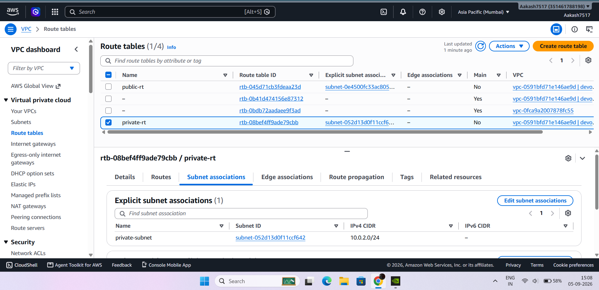 | 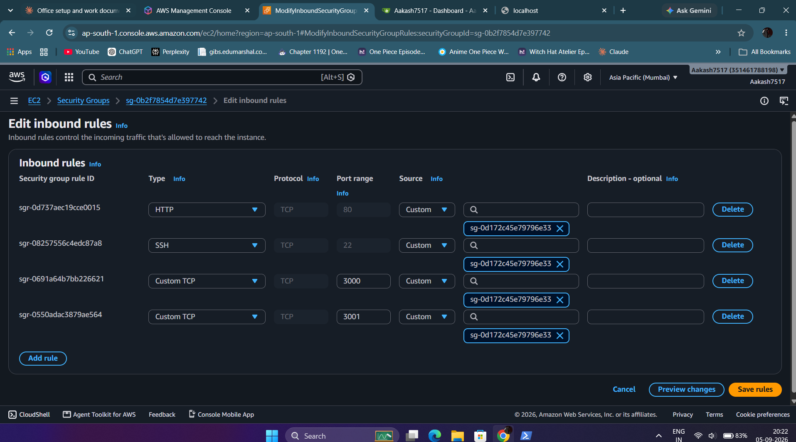 |
| **hello-devops-app running live** | **Gitea repo activity (real commit history)** |
| 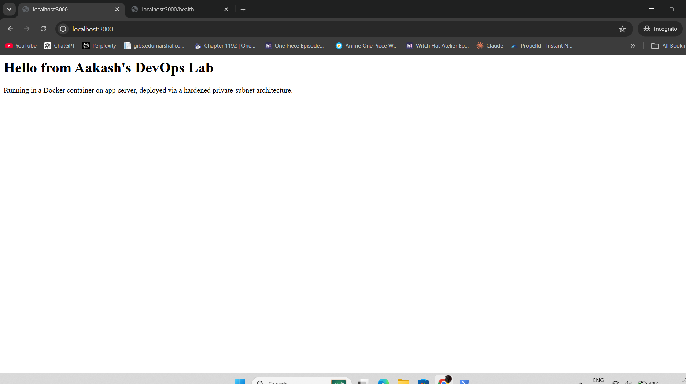 | 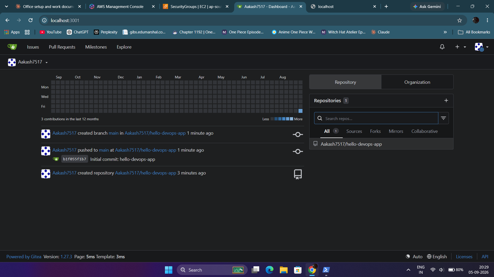 |
| **CI/CD pipeline run — green, automated** | **Self-hosted Actions runner registered** |
| 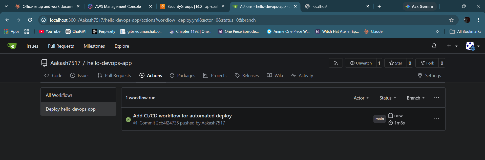 | 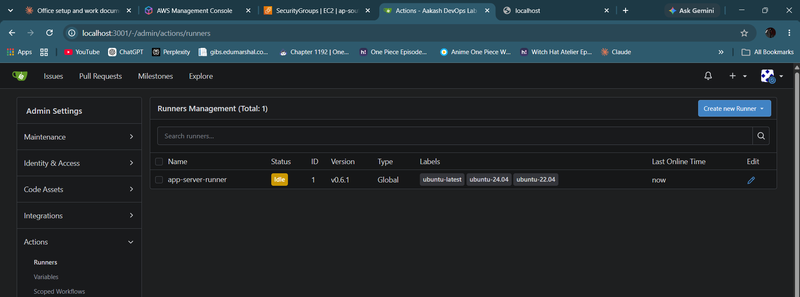 |

## Usage

```bash
cd terraform
terraform init
terraform plan -var="key_name=YOUR_KEY_PAIR"
terraform apply

cd ../ansible
ansible-playbook -i inventory.ini site.yml
```

Remember to `terraform destroy` when you're done — this is a demo lab, not
something to leave running.

## Notes

All hostnames, IP ranges, and domains here are placeholders for a portfolio
project and do not correspond to any real environment.

---

## v2: Self-hosted GitLab + CI/CD on a segmented AWS VPC

A second build of the lab, built manually in the AWS Console first (SAA practice), with GitLab CE replacing Gitea. Every push to `main` automatically rebuilds and redeploys the app.

### Architecture

| Component | Detail |
|---|---|
| Region / VPC | ap-southeast-1, `devops-lab-vpc` (10.0.0.0/16) |
| `public-subnet` | 10.0.1.0/24, routes to IGW; hosts `bastion` and the NAT gateway |
| `private-subnet` | 10.0.2.0/24, routes to NAT gateway; hosts the app and git servers |
| `bastion` | t3.micro, only SSH entry point, restricted to my IP |
| `app-server` | t3.micro, Docker + GitLab Runner (shell executor), runs `hello-devops-app` |
| `git-server` | c7i-flex.large (4 GB RAM), 30 GB disk, 2 GB swap, GitLab CE (Omnibus) |
| Security groups | `bastion-sg` (22 from my IP), `private-sg` (22 and 80 from `bastion-sg`, self-referencing rule for internal traffic) |

Private servers have no public IPs. Access is through the bastion with SSH `ProxyCommand`, and the GitLab UI is reached through an SSH tunnel (`-L 8080:localhost:80`).

### Hardening (all 3 servers)

- `labadmins` group
- Root login and password authentication disabled via `/etc/ssh/sshd_config.d/10-hardening.conf`
- fail2ban with an `sshd` jail
- Unattended kernel updates applied and servers rebooted

### CI/CD flow

```
git push (app-server) -> GitLab (git-server) -> GitLab Runner (app-server)
   -> docker build -> replace container -> curl /health check
```

Pipeline definition: `.gitlab-ci.yml`. A change from `v1` to `v2` in `app.js` went live with no manual steps.

### Proof

| | |
|---|---|
| VPC resource map | 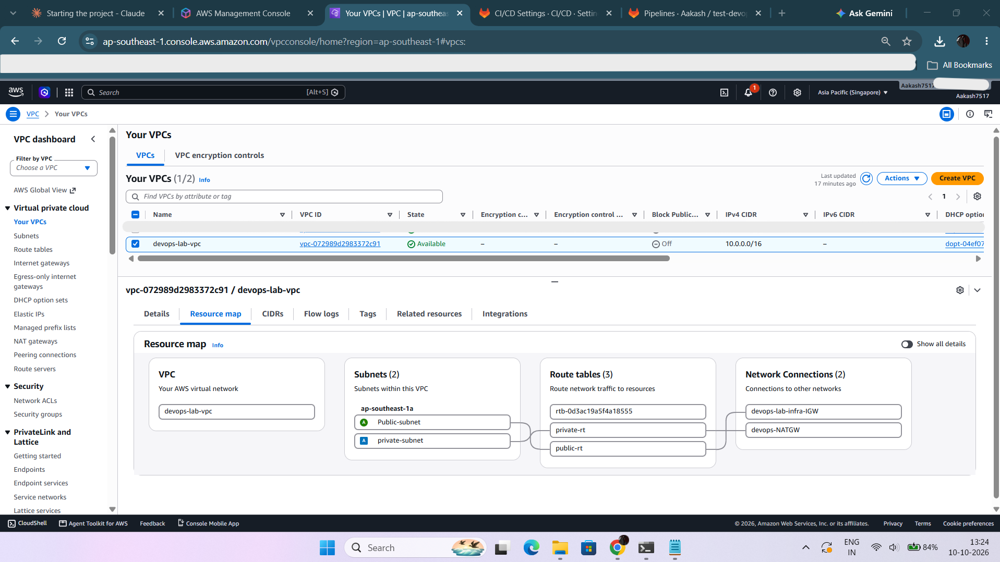 |
| EC2 instances | 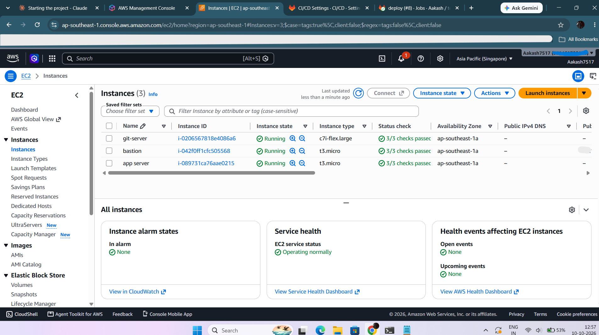 |
| Pipelines | 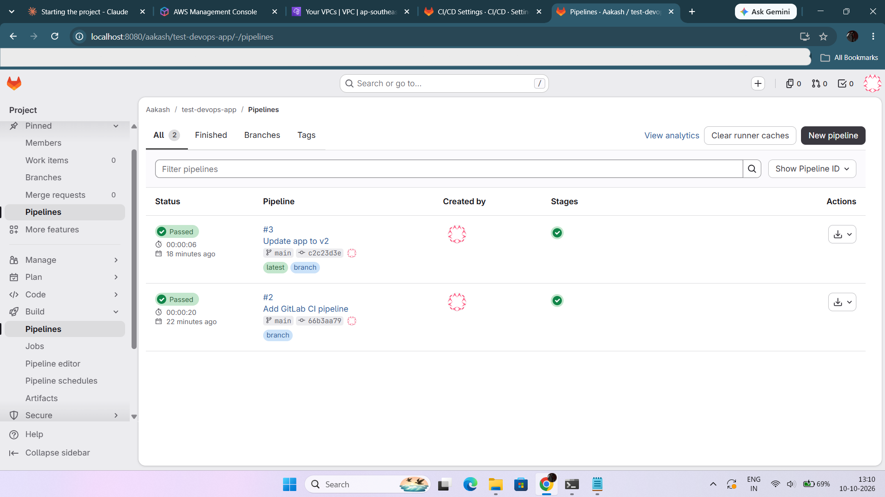 |
| Deploy job log | 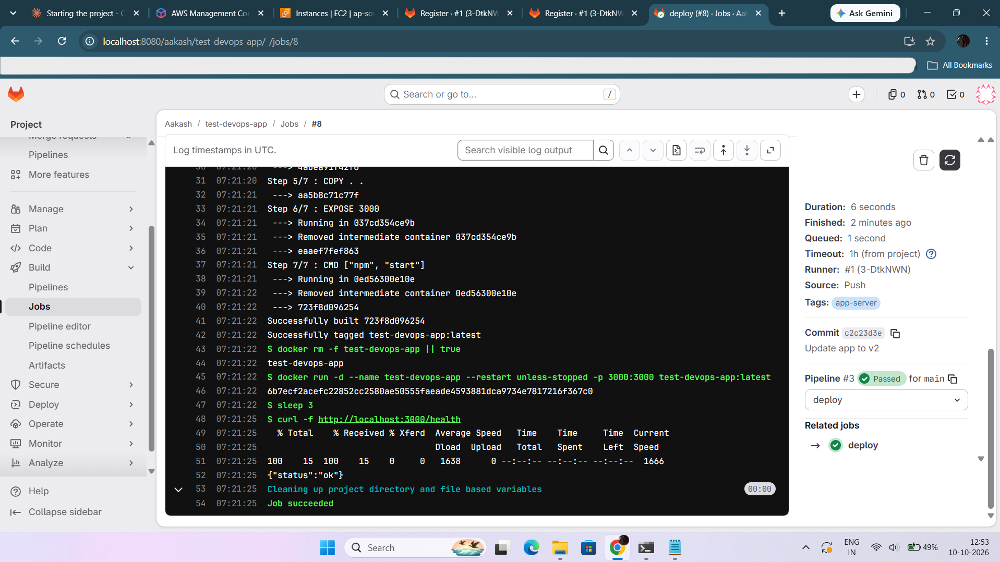 |
| Runner online | 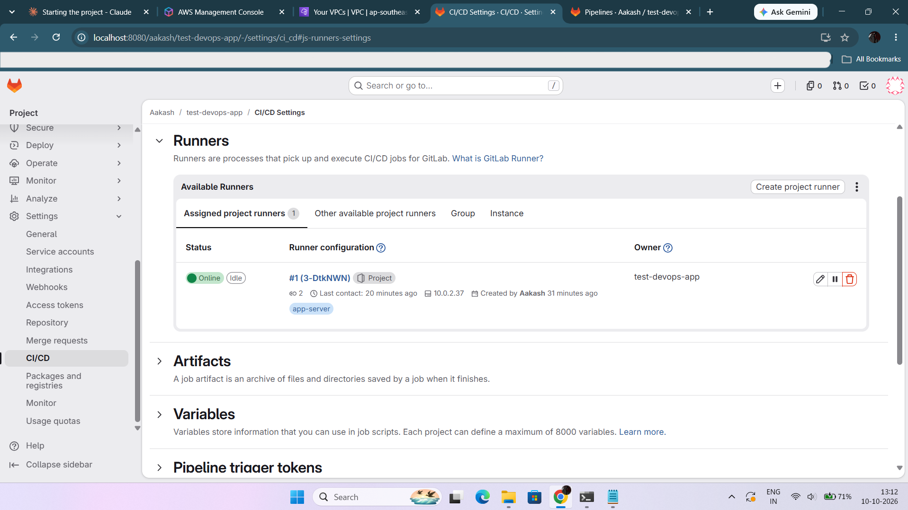 |
| Live app (v2) | 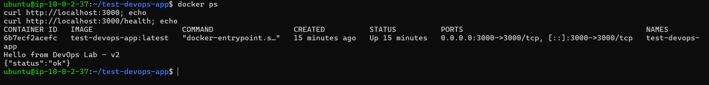 |

### Real issues hit and fixed

Full details in `docs/BUILD_LOG_v2.md`. Highlights:

- SSH `Permission denied (publickey)`: the `.pem` did not match the key pair attached to the instance
- `ssh -J` does not reuse the `-i` key for the jump host, so `ProxyCommand` was used
- GitLab consumed ~3 GB of a 4 GB box; bundled Prometheus and other services were disabled to bring available memory from 773 MB to 1.6 GB
- GitLab redirected the browser to its private `external_url`, which timed out through the tunnel
- Auto DevOps created a failing default pipeline on the first commit

### Phase 7: Jenkins blue-green deploy with one-click rollback

Jenkins pulls the `Jenkinsfile` from GitLab (Pipeline script from SCM) and deploys the app to `app-server` with zero downtime. It runs alongside the GitLab CI pipeline above as an alternative deployment strategy.

| Stage | What it does |
|---|---|
| Test | `npm test` inside a `node:22-alpine` container |
| Build | `docker build`, image tagged with the build number |
| Blue-Green Deploy | New container starts on the idle slot (13001/13002), passes a health check, then Nginx is switched and reloaded; the old slot stays up |
| Manual Rollback | `ACTION=rollback` flips Nginx back to the previous slot and verifies it against `/health` |

Verified: polling `/health` every 0.2 s during a deploy and during a rollback returned only HTTP 200. Rollback from build 30 to build 29 confirmed live.

Full write-up, screenshots and logs: [`docs/phase-7-jenkins/`](docs/phase-7-jenkins/README.md)

### Next

Prometheus/Grafana/Alertmanager, MariaDB replication + Redis, Kubernetes (minikube, then an EKS proof of concept), Ansible playbooks, and Terraform.
