# Segmented Network Lab on AWS — Console Build + Terraform/Ansible

A self-hosted, segmented infrastructure environment on AWS — modeled on a
production on-prem DMZ/LAN/VPN architecture I built and hardened at work,
reimplemented here with sanitized names, IPs, and domains for a public
portfolio.

This repo contains **two parallel versions** of the same architecture:

1. **A real, hand-built deployment** (documented in full in
   [`docs/BUILD_LOG.md`](docs/BUILD_LOG.md)) — built manually through the AWS
   Console specifically for hands-on AWS Solutions Architect Associate exam
   practice, then hardened, containerized, and wired up with a working
   CI/CD pipeline.
2. **An Infrastructure-as-Code version** (`terraform/` + `ansible/`) —
   the same network topology and hardening steps, expressed as repeatable,
   version-controlled code instead of console clicks.

Building it by hand first, then codifying it, was deliberate: it's the
difference between clicking through a wizard and actually understanding what
each resource does — which is also exactly what the SAA exam tests.

## What this demonstrates

- **Network segmentation** — public (DMZ-equivalent) and private
  (LAN-equivalent) subnets, with a bastion host as the only entry point,
  NAT Gateway for outbound-only private access
- **Server hardening** — SSH key-only auth, root login disabled, an admin
  group, fail2ban — done manually first, then enforced on every server by
  Ansible roles
- **Self-hosted services** — a self-hosted Git server (Gitea in v1, GitLab CE
  in v2) and a containerized app (Node.js/Express + a self-authored
  Dockerfile), both running in the private subnet, reachable only through the
  bastion
- **CI/CD** — a real, working pipeline: pushing code automatically rebuilds
  the Docker image and redeploys the container (Gitea Actions in v1, GitLab CI
  and a Jenkins blue-green pipeline in v2)
- **Infrastructure as Code** — the whole running lab described in Terraform
  (adopted with `import`, no recreation) and configured by idempotent Ansible
  roles, with a GitHub Actions job that runs `fmt`, `init` and `validate` on
  pull requests and on pushes to `main` that change the Terraform code
- **Debugging discipline** — every real issue hit along the way (security
  group gaps, SSH config mistakes, a corrupted config file, dynamic-IP
  lockouts) is documented with its actual root cause and fix in
  [`docs/BUILD_LOG.md`](docs/BUILD_LOG.md) — troubleshooting is as much a
  part of this project as the final working state

## Architecture

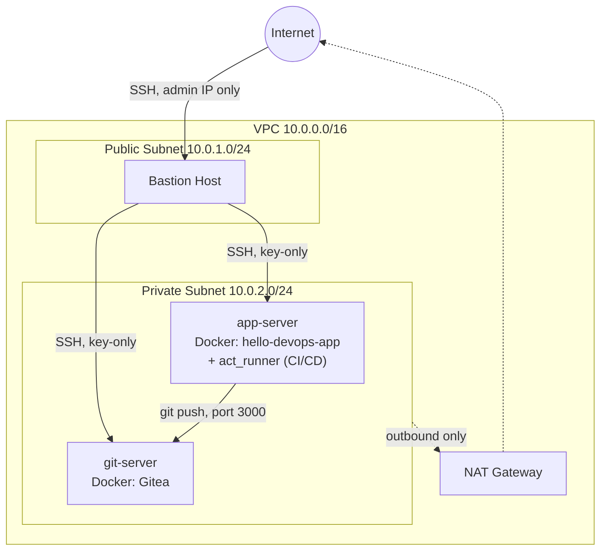

This mirrors a real DMZ/LAN/VPN-segmented on-prem network I run at work: a
single hardened entry point, everything else reachable only through it, and
no direct internet exposure for internal services.

**How CI/CD works end-to-end (v1):** a push to the `main` branch on Gitea
(git-server) triggers a Gitea Actions workflow, executed by a self-hosted
runner living on app-server. The runner rebuilds the Docker image and
replaces the running container — no manual `docker build`/`docker run`
after the initial setup. Full details in
[`docs/BUILD_LOG.md`](docs/BUILD_LOG.md).

## Repo layout

```
terraform/      VPC, subnets, security groups, EC2 instances (IaC version of the original lab)
terraform-v2/   the whole v2 lab (network, 5 instances, Jenkins IAM role), portable to any account; see its README
ansible/        roles for the whole v2 lab: hardening baseline (all hosts), app host, GitLab, Jenkins
REBUILD.md      runbook: empty AWS account to a working lab, including the GitLab and Jenkins restores
docs/           build logs (v1 + v2), Phase 7 Jenkins blue-green docs, screenshots
.github/        GitHub Actions: terraform fmt/validate for terraform/ and terraform-v2/
```

## Screenshots

| | |
|---|---|
| **Route table wired to NAT Gateway** | **Security group rules (bastion-sourced + self-referencing)** |
| 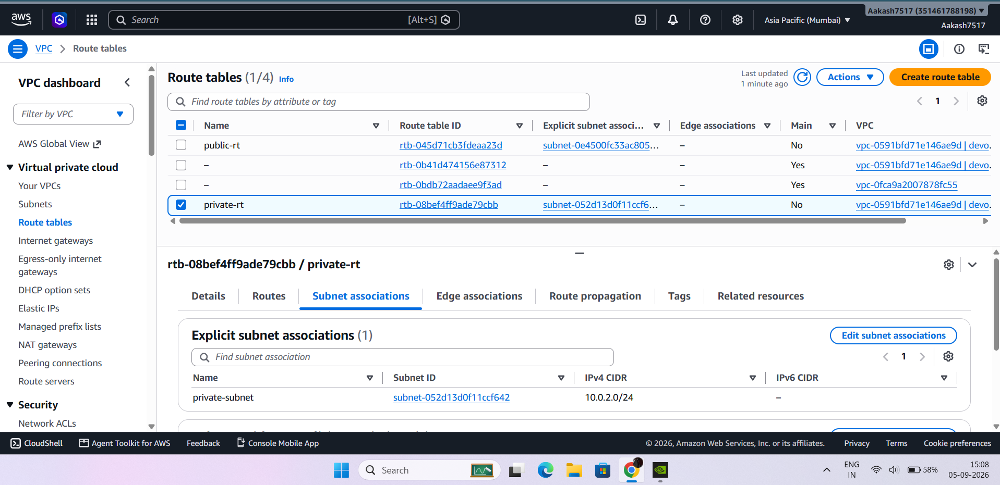 | 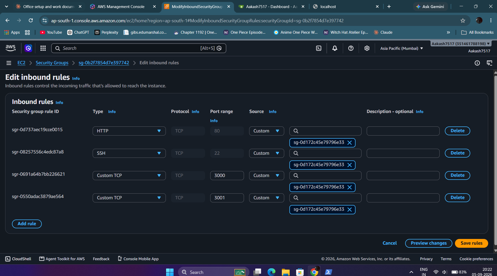 |
| **hello-devops-app running live** | **Gitea repo activity (real commit history)** |
| 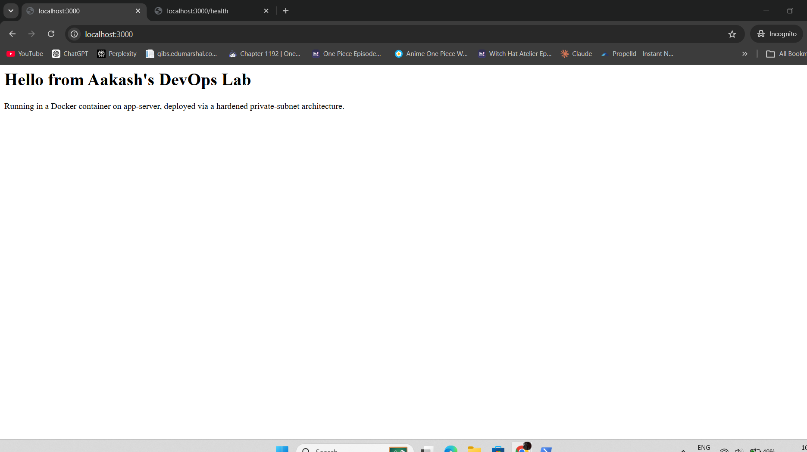 | 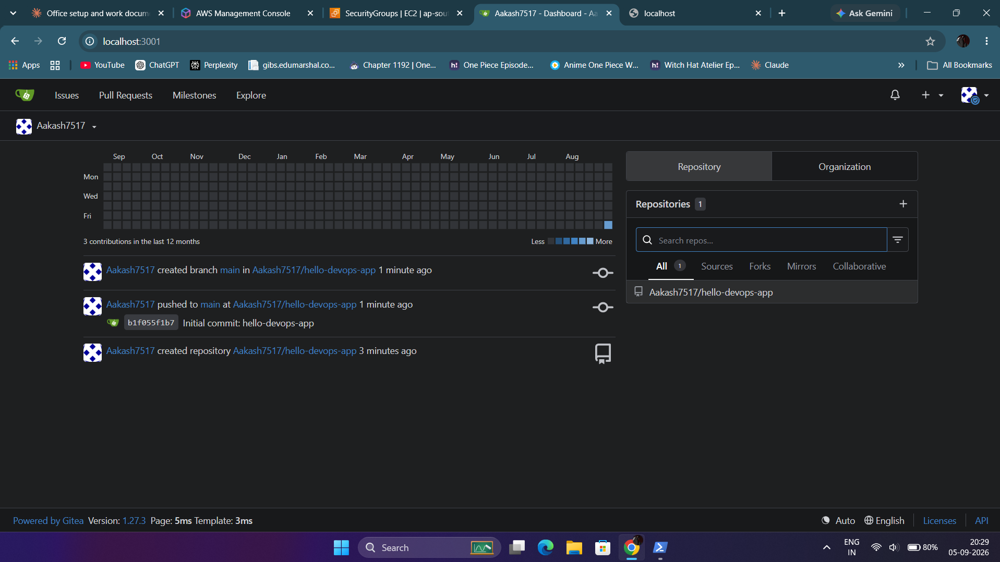 |
| **CI/CD pipeline run — green, automated** | **Self-hosted Actions runner registered** |
| 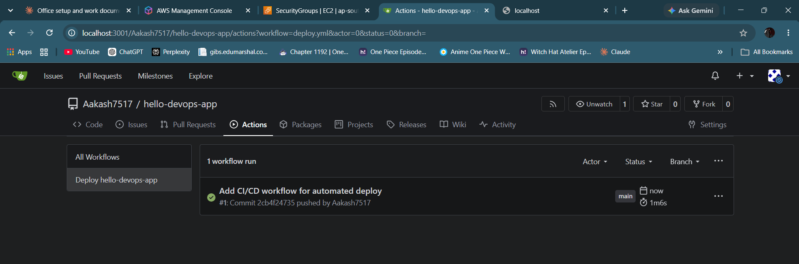 | 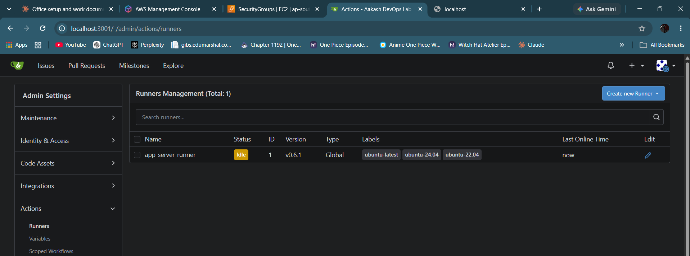 |

## Usage

```bash
cd terraform-v2
terraform init
terraform plan
terraform apply

# Ansible runs on the bastion; see "Ansible for every server" below
```

The full rebuild, including restoring GitLab and Jenkins from backups, is in
[`REBUILD.md`](REBUILD.md).

Remember to `terraform destroy` when you're done — this is a demo lab, not
something to leave running.

## Notes

All hostnames, IP ranges, and domains here are placeholders for a portfolio
project and do not correspond to any real environment.

---

## v2: Self-hosted GitLab + CI/CD on a segmented AWS VPC

A second build of the lab, built manually in the AWS Console first (SAA practice), with GitLab CE replacing Gitea. Every push to `main` automatically rebuilds and redeploys the app.

### Architecture

| Component | Detail |
|---|---|
| Region / VPC | ap-southeast-1, `devops-lab-vpc` (10.0.0.0/16) |
| `public-subnet` | 10.0.1.0/24, routes to IGW; hosts `bastion` and the NAT gateway |
| `private-subnet` | 10.0.2.0/24, routes to NAT gateway; hosts the app, git and Jenkins servers |
| `bastion` | t3.micro, only SSH entry point, restricted to my IP; also the Ansible control node |
| `app-server` | t3.micro, Docker + GitLab Runner (shell executor) + Nginx blue-green front, runs `hello-devops-app` |
| `git-server` | c7i-flex.large (4 GB RAM), 30 GB disk, 2 GB + 4 GB swap, GitLab CE (Omnibus) |
| `jenkins-server` | t3.small, private subnet, Jenkins (deploys the app above and ShopSphere); EC2 role for ECR and EKS |
| `shopsphere-minikube` | m7i-flex.large, public subnet, Minikube host for [ShopSphere](https://github.com/Aakash17-hub/shopsphere) |
| Security groups | `Bastion-SG` (22 from my IP), `Private-SG` (22 and 80 from the bastion and from the Minikube host, self-referencing rule for internal traffic), `shopsphere-sg` (22 from the bastion and from the Jenkins server) |

The NAT gateway is deleted between sessions to save cost. The lab currently runs without one, so the private servers have no internet access until it is recreated (`enable_nat` in `terraform-v2/`).

Private servers have no public IPs. Access is through the bastion with SSH `ProxyCommand`, and the GitLab UI is reached through an SSH tunnel (`-L 8080:localhost:80`).

### Hardening (bastion and all private servers, enforced by Ansible)

- `labadmins` group
- One SSH drop-in, `/etc/ssh/sshd_config.d/10-hardening.conf`: root login, password and keyboard-interactive auth off, key-only auth, `MaxAuthTries 3`, X11 forwarding off
- fail2ban with an `sshd` jail (5 retries, 1 h ban)
- Unattended kernel updates applied and servers rebooted

### CI/CD flow

```
git push (app-server) -> GitLab (git-server) -> GitLab Runner (app-server)
   -> docker build -> replace container -> curl /health check
```

Pipeline definition: `.gitlab-ci.yml`. A change from `v1` to `v2` in `app.js` went live with no manual steps.

### Proof

| | |
|---|---|
| VPC resource map | 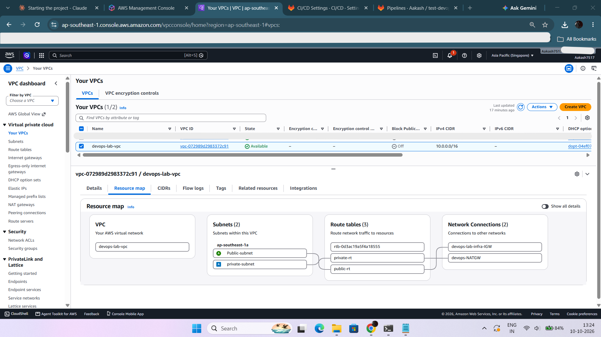 |
| EC2 instances | 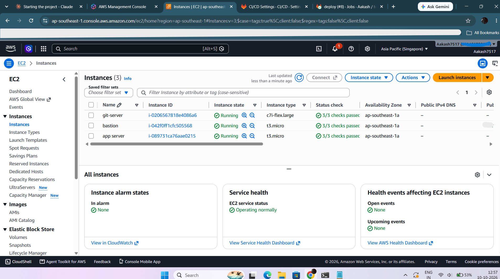 |
| Pipelines | 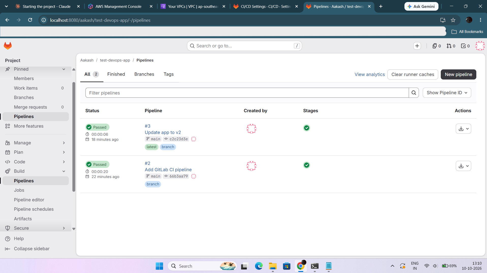 |
| Deploy job log | 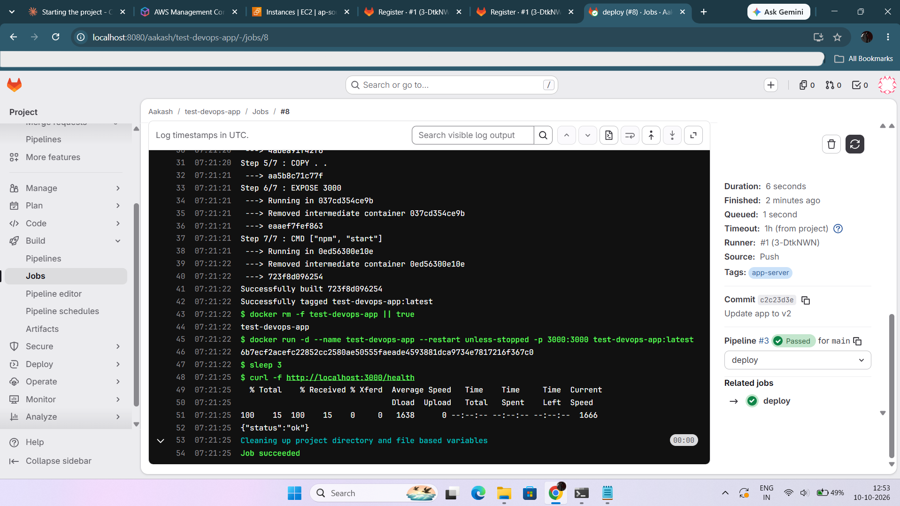 |
| Runner online | 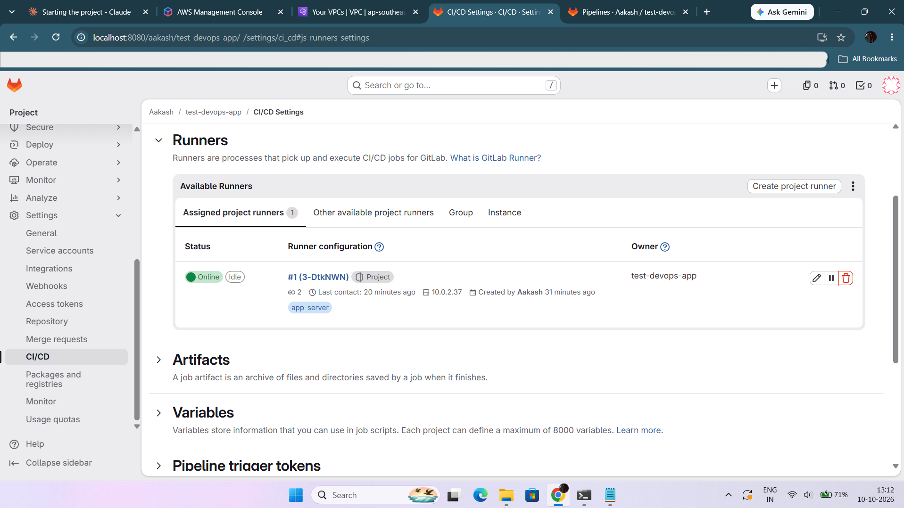 |
| Live app (v2) | 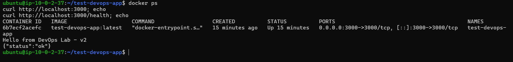 |

### Real issues hit and fixed

Full details in `docs/BUILD_LOG_v2.md`. Highlights:

- SSH `Permission denied (publickey)`: the `.pem` did not match the key pair attached to the instance
- `ssh -J` does not reuse the `-i` key for the jump host, so `ProxyCommand` was used
- GitLab consumed ~3 GB of a 4 GB box; bundled Prometheus and other services were disabled to bring available memory from 773 MB to 1.6 GB
- GitLab redirected the browser to its private `external_url`, which timed out through the tunnel
- Auto DevOps created a failing default pipeline on the first commit

### Phase 7: Jenkins blue-green deploy with one-click rollback

Jenkins pulls the `Jenkinsfile` from GitLab (Pipeline script from SCM) and deploys the app to `app-server` with zero downtime. It runs alongside the GitLab CI pipeline above as an alternative deployment strategy.

| Stage | What it does |
|---|---|
| Test | `npm test` inside a `node:22-alpine` container |
| Build | `docker build`, image tagged with the build number |
| Blue-Green Deploy | New container starts on the idle slot (13001/13002), passes a health check, then Nginx is switched and reloaded; the old slot stays up |
| Manual Rollback | `ACTION=rollback` flips Nginx back to the previous slot and verifies it against `/health` |

Verified: polling `/health` every 0.2 s during a deploy and during a rollback returned only HTTP 200. Rollback from build 30 to build 29 confirmed live.

Full write-up, screenshots and logs: [`docs/phase-7-jenkins/`](docs/phase-7-jenkins/README.md)

### Terraform for the lab as it runs today

[`terraform-v2/`](terraform-v2/README.md) describes the whole current lab (VPC, subnets, route tables, three security groups, five instances). The existing resources were **imported**, not recreated: the plan showed 17 imports and 5 in-place changes (termination protection only), and a second plan after the apply showed no changes.

The Jenkins server's IAM role (`jenkins-ec2-role`: `AmazonEC2ContainerRegistryPowerUser` plus an inline policy for `eks:DescribeCluster` and `eks:ListClusters`) and its instance profile were adopted the same way later (4 imports, then no changes).

Since then the code has been made portable (AMI looked up from Canonical, key pair created from a public key, admin IP detected on every plan, AZ taken from the region), and on 13 Nov 2026 the whole lab was destroyed and rebuilt from it. See [Rebuild from scratch](#rebuild-from-scratch-13-nov-2026) below.

### Ansible for every server

[`ansible/`](ansible/) configures the four lab hosts (bastion, app, git and Jenkins servers). The Minikube host has its own playbook in ShopSphere.

| Role | Hosts | What it manages |
|---|---|---|
| `ssh-hardening` | all | `labadmins` group, the SSH drop-in, `sshd -t` check before any restart |
| `fail2ban` | all | package, `sshd` jail, service |
| `app-host` | app-server | Docker, Nginx, the blue-green site, `deploy.sh` / `rollback.sh`, GitLab Runner (pinned and held) |
| `gitlab` | git-server | 2 GB + 4 GB swap files, GitLab CE (pinned and held), the lean `gitlab.rb` settings |
| `jenkins` | jenkins-server | Java 21, Jenkins (pinned and held), Docker, git, AWS CLI v2, kubectl (checksum verified) |

**How it was built:** the live state of each server was read first, the roles were written to match it, then `--check --diff`, a real run, and a second run that reported `changed=0` on all four hosts.

**Drift it caught:** `jenkins-server` was built later than the others and had a different SSH drop-in, no `labadmins` group and no fail2ban. The baseline roles brought it in line with the rest.

**Design choices**

- The bastion is the control node. Keys reach the private servers through agent forwarding (`ssh -A`), so no private key is stored on the bastion.
- `deploy.sh` rewrites the Nginx upstream port on every release, so the role only seeds that file on a new host (`force: false`) and never resets the live port.
- GitLab, GitLab Runner and Jenkins come from third-party repos and are pinned and held, so a rebuild gets the same versions. Ubuntu packages are not pinned, because old versions leave the Ubuntu mirrors.

**Run it** (a fresh install needs outbound internet, so set `enable_nat = true` in `terraform-v2/` first):

```bash
ssh -A ubuntu@<bastion-public-ip>
sudo apt install -y ansible-core && ansible-galaxy collection install ansible.posix
git clone https://github.com/Aakash17-hub/devops-lab-infra && cd devops-lab-infra/ansible
cp inventory.ini.example inventory.ini   # private IPs from `terraform output private_ips`
ansible-playbook -i inventory.ini site.yml --check --diff
ansible-playbook -i inventory.ini site.yml
```

**Manual steps (secrets stay out of the repo):** GitLab Runner registration tokens, and restoring GitLab and Jenkins from their backups (users, credentials and jobs live there). The Jenkins deploy key on `app-server` is now in the `app-host` role; it is a public key.

### Rebuild from scratch (13 Nov 2026)

The lab was backed up, destroyed with `terraform destroy` (21 resources) and rebuilt from this repository into the same account, following [`REBUILD.md`](REBUILD.md).

| Step | Result |
|---|---|
| `terraform apply` | 25 resources created (lab + key pair + temporary NAT gateway) |
| `ansible-playbook site.yml` on fresh servers | all four hosts configured; a second run reported `changed=0` on every host |
| GitLab restore (`gitlab-backup restore` + `gitlab-secrets.json`) | 4 projects, 3 users, pipeline history back; `gitlab:doctor:secrets` reported 0 failures |
| Jenkins restore (home folder + plugin list) | 4 jobs and their credentials back; 95 plugins installed with the Plugin Installation Manager against the pinned 2.580.1 WAR |
| Jenkins blue-green deploy | `test-devops-app-pipeline` released build 32 to the Green slot, `/health` healthy |
| ShopSphere | Minikube started by its playbook; GitLab CI and the Jenkins pipeline both deployed it (11 pods `Running`) |
| Monitoring | kube-prometheus-stack 92.17.0 and blackbox 11.20.2 reinstalled; a test alert reached Slack |

**Bugs the rebuild found** (none of them showed up while the code was only checked against the running servers):

- **GitLab Runner pin:** current runner packages depend on `gitlab-runner-helper-images` of the exact same version, so pinning only `gitlab-runner` made apt refuse to install. Both packages are now pinned and held.
- **Jenkins repository key:** the 2023 signing key expired in March 2026 and the LTS repository is signed with `jenkins.io-2026.key`. The role now uses the new key and refreshes the apt cache when the key changes.
- **Jenkins deploy key:** the public key behind Jenkins' `app-server-ssh` credential had been added to `app-server` by hand. It is now in the `app-host` role.
- **ShopSphere playbook:** it added the GitLab Runner repository without refreshing the apt cache, so the install failed on a fresh host. Fixed in the ShopSphere repository.

| | |
|---|---|
| Second Ansible run on the rebuilt lab | 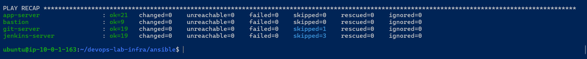 |
| Test alert from the rebuilt monitoring stack | 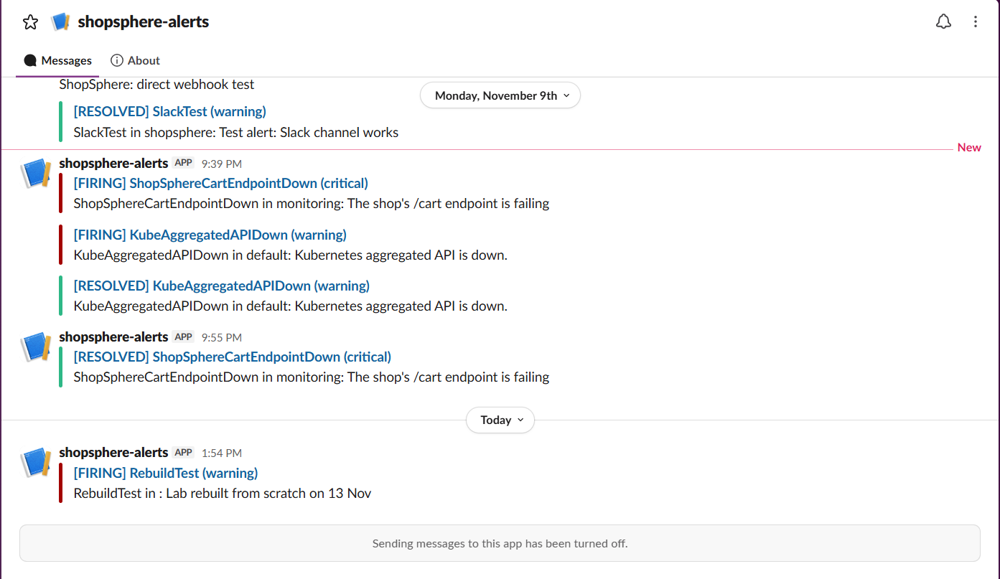 |

### Related projects

- [ShopSphere](https://github.com/Aakash17-hub/shopsphere): Kubernetes (Minikube on this lab's EC2), GitLab CI and a Jenkins deploy pipeline, Prometheus/Grafana/Alertmanager with Slack alerts, an Ansible playbook for the Minikube host
- [boutique-eks](https://github.com/Aakash17-hub/boutique-eks): GitLab to Jenkins to ECR to EKS pipeline with scoped RBAC and automatic rollback

### Next

MariaDB replication and Redis, centralised logging, AWS SSM Session Manager instead of SSH to the bastion, and codifying the remaining manual rebuild steps (runner registration, the CI kubeconfig on the Minikube host).
