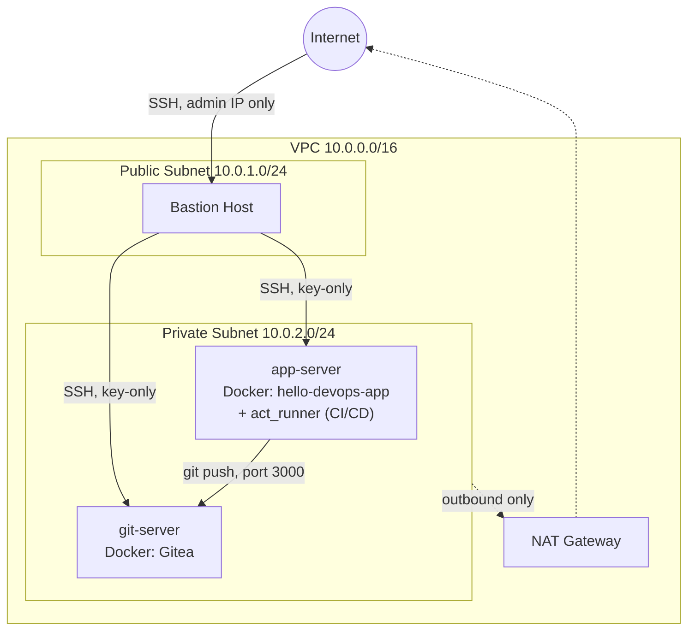

# Segmented Network Lab on AWS — Console Build + Terraform/Ansible

A self-hosted, segmented infrastructure environment on AWS — modeled on a
production on-prem DMZ/LAN/VPN architecture I built and hardened at work,
reimplemented here with sanitized names, IPs, and domains for a public
portfolio.

This repo contains **two parallel versions** of the same architecture:

1. **A real, hand-built deployment** (documented in full in
   [`docs/BUILD_LOG.md`](docs/BUILD_LOG.md)) — built manually through the AWS
   Console specifically for hands-on AWS Solutions Architect Associate exam
   practice, then hardened, containerized, and wired up with a working
   CI/CD pipeline.
2. **An Infrastructure-as-Code version** (`terraform/` + `ansible/`) —
   the same network topology and hardening steps, expressed as repeatable,
   version-controlled code instead of console clicks.

Building it by hand first, then codifying it, was deliberate: it's the
difference between clicking through a wizard and actually understanding what
each resource does — which is also exactly what the SAA exam tests.

## What this demonstrates

- **Network segmentation** — public (DMZ-equivalent) and private
  (LAN-equivalent) subnets, with a bastion host as the only entry point,
  NAT Gateway for outbound-only private access
- **Server hardening** — SSH key-only auth, root login disabled, role-named
  service accounts, fail2ban — done manually first, then via reusable
  Ansible roles
- **Self-hosted services** — a self-hosted Git server (Gitea) and a
  containerized app (Node.js/Express + a self-authored Dockerfile), both
  running in the private subnet, reachable only through the bastion
- **CI/CD** — a real, working Gitea Actions pipeline: pushing code
  automatically rebuilds the Docker image and redeploys the container, with
  zero manual `docker` commands after setup
- **Infrastructure as Code** — the same topology reproduced in Terraform,
  with a GitHub Actions job that validates it on every push
- **Debugging discipline** — every real issue hit along the way (security
  group gaps, SSH config mistakes, a corrupted config file, dynamic-IP
  lockouts) is documented with its actual root cause and fix in
  [`docs/BUILD_LOG.md`](docs/BUILD_LOG.md) — troubleshooting is as much a
  part of this project as the final working state

## Architecture



This mirrors a real DMZ/LAN/VPN-segmented on-prem network I run at work: a
single hardened entry point, everything else reachable only through it, and
no direct internet exposure for internal services.

**How CI/CD works end-to-end:** a push to the `main` branch on Gitea
(git-server) triggers a Gitea Actions workflow, executed by a self-hosted
runner living on app-server. The runner rebuilds the Docker image and
replaces the running container — no manual `docker build`/`docker run`
after the initial setup. Full details in
[`docs/BUILD_LOG.md`](docs/BUILD_LOG.md).

## Repo layout

```
terraform/   VPC, subnets, security groups, EC2 instances (IaC version)
ansible/     SSH-hardening and fail2ban roles (IaC version)
docs/        Full build log — all 4 phases, every issue and its real fix
```

## Screenshots

| | |
|---|---|
| **Route table wired to NAT Gateway** | **Security group rules (bastion-sourced + self-referencing)** |
|  |  |
| **hello-devops-app running live** | **Gitea repo activity (real commit history)** |
|  |  |
| **CI/CD pipeline run — green, automated** | **Self-hosted Actions runner registered** |
|  |  |

## Usage

```bash
cd terraform
terraform init
terraform plan -var="key_name=YOUR_KEY_PAIR"
terraform apply

cd ../ansible
ansible-playbook -i inventory.ini site.yml
```

Remember to `terraform destroy` when you're done — this is a demo lab, not
something to leave running.

## Notes

All hostnames, IP ranges, and domains here are placeholders for a portfolio
project and do not correspond to any real environment.
