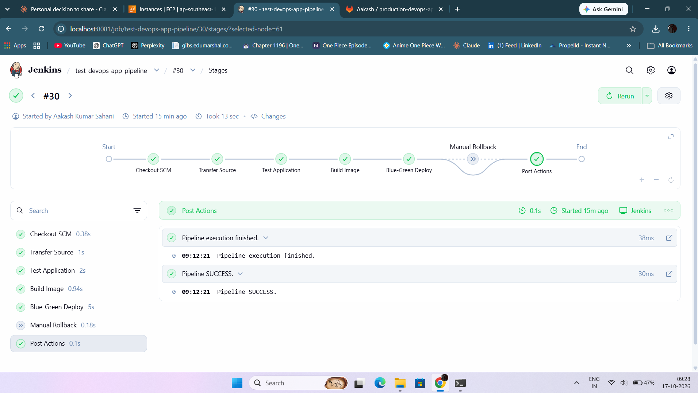
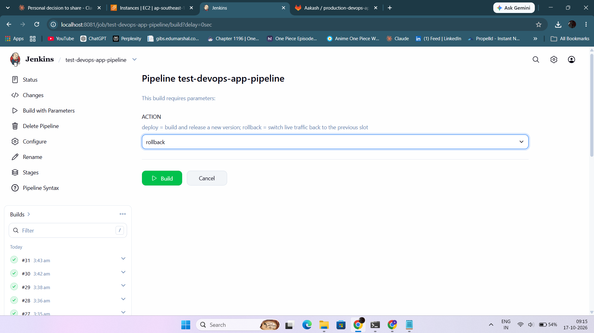
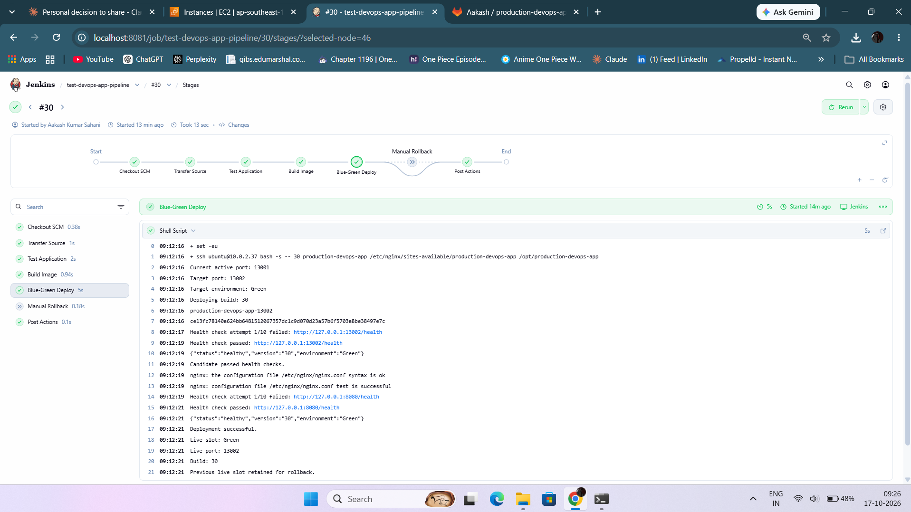
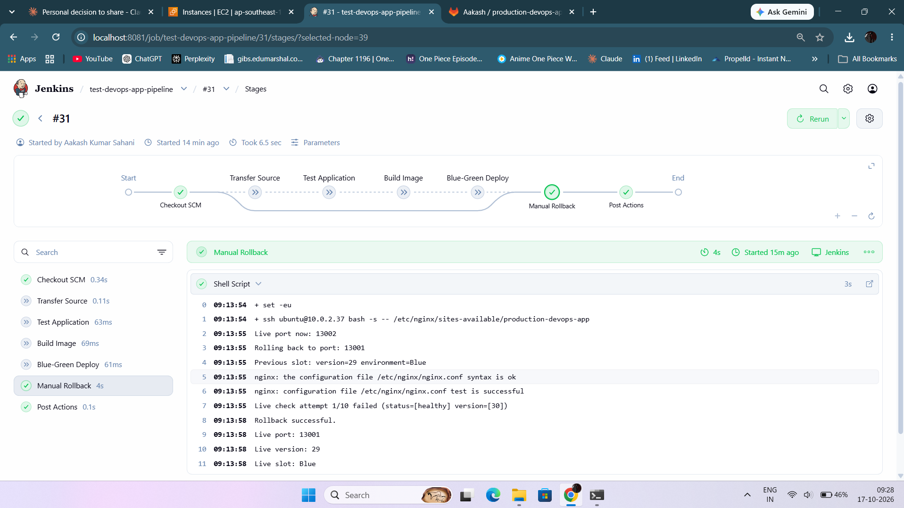
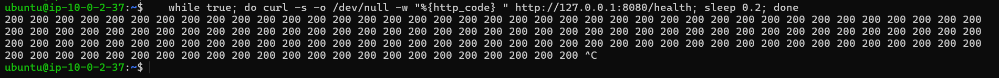
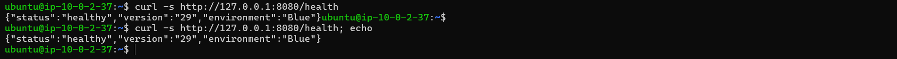

# production-devops-app

A small Node.js service deployed through a **Jenkins CI/CD pipeline** with **zero-downtime blue-green releases** and a **one-click rollback**, running on AWS inside a segmented VPC lab.

## Architecture

```
Developer ──push──▶ GitLab ──checkout──▶ Jenkins ──ssh──▶ App server
                                                            │
                                         Nginx :8080 ───────┤
                                            ├─▶ Blue  container  :13001
                                            └─▶ Green container  :13002
```

| Component | Role |
|-----------|------|
| GitLab (self-hosted) | Source of truth; stores the app and the `Jenkinsfile` |
| Jenkins | Runs the pipeline (`Pipeline script from SCM`) |
| App server | Docker host + Nginx reverse proxy |
| Nginx | Public entry point on port 8080; `proxy_pass` points at the live slot |
| Blue / Green | Two identical containers on ports 13001 and 13002; only one is live |

All servers sit in private subnets. Admin access goes through a bastion host and SSH tunnels.

## The application

- Node.js 22 (Alpine), runs as the non-root `node` user
- `GET /health` returns JSON with `status`, `version` (the Jenkins build number) and `environment` (`Blue` or `Green`)
- Tests run with the built-in `node --test` runner

## Pipeline

The pipeline is defined in [`Jenkinsfile`](Jenkinsfile) and has a build parameter, `ACTION`.

### `ACTION = deploy` (default)

1. **Transfer Source**: archive the checked-out repo and copy it to the app server
2. **Test Application**: run `npm test` inside a `node:22-alpine` container
3. **Build Image**: `docker build` and tag the image with the build number
4. **Blue-Green Deploy**:
   - Read the live port from the Nginx config and pick the *other* slot as the target
   - Start the new container on the idle slot
   - Health-check the candidate directly (status, version and environment must all match)
   - Back up the Nginx config, switch `proxy_pass`, run `nginx -t`, reload Nginx
   - Health-check the live route on port 8080
   - If any step after the switch fails, the Nginx config is restored and the candidate container is removed
   - The previous slot stays running so it can be rolled back to

### `ACTION = rollback`

Runs only the **Manual Rollback** stage (the other stages are skipped):

1. Find the live slot and the previous slot
2. Confirm the previous container is running and reports `healthy`
3. Switch Nginx back to it, validate, reload
4. Verify the live route now serves the previous version; if not, restore the config automatically

## Safety properties

- New code never receives traffic until it has passed its own health check
- Nginx config is validated (`nginx -t`) before every reload
- Failed deployments revert automatically; the idle slot is always kept for rollback
- Health checks verify the *version* and *environment*, so a stale container cannot pass by accident

## Test results

| Test | Result |
|------|--------|
| Pipeline from SCM (builds #22, #28–#31) | All passed |
| Blue ↔ Green switch (13001 ↔ 13002) | Slots alternate on every deploy |
| Zero-downtime check during a deploy | Only HTTP 200 returned while polling `/health` every 0.2 s |
| Manual rollback (build 30 → build 29) | Passed; live version confirmed as 29 |
| Zero-downtime check during rollback | Only HTTP 200 returned |

Evidence (screenshots and raw logs) is in this folder.

### Screenshots

| | |
|---|---|
| Jenkins stage view (deploy) |  |
| Build with Parameters (`ACTION`) |  |
| Deploy console log |  |
| Rollback console log |  |
| Zero-downtime loop test |  |
| Health endpoint after rollback (version 29, Blue) |  |

### Logs

- [`logs/deploy-build-30.txt`](logs/deploy-build-30.txt)
- [`logs/rollback-build-31.txt`](logs/rollback-build-31.txt)
- [`logs/loop-test.txt`](logs/loop-test.txt)

## How to run

**Deploy:** Jenkins job, *Build Now* (or *Build with Parameters*, `ACTION = deploy`).

**Rollback:** Jenkins job, *Build with Parameters*, `ACTION = rollback`.

**Check what is live:**

```bash
curl -s http://127.0.0.1:8080/health
# {"status":"healthy","version":"<build>","environment":"Blue|Green"}
```

**Zero-downtime check:**

```bash
while true; do curl -s -o /dev/null -w "%{http_code} " http://127.0.0.1:8080/health; sleep 0.2; done
```

## Known limitations and next steps

- Rollback only goes back one release (it flips between the two slots)
- Source is extracted straight into the app directory before tests run; a versioned `releases/<build>` layout with a `current` symlink would be safer
- The image is built on the app server; the next step is pushing it to a container registry
- This pipeline is the foundation for the Kubernetes project (ShopSphere), where Blue-Green becomes Deployments, probes and rolling updates
